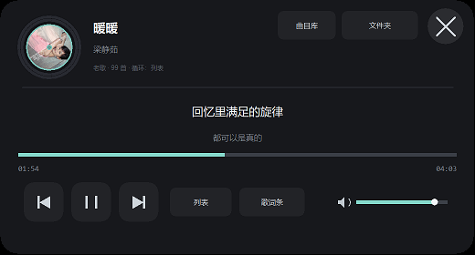

# LyricsBar

**极低内存的 Windows 本地音乐播放器。** 原生 C++ / Win32 / GDI 自绘，后台播放常驻内存约 **5 MB**，单文件绿色版，双击即用。

> 代码由 AI 辅助创作，配套发布视频全部由 AI 生成。

仓库：<https://github.com/BrocadeHutHost/LyricsBar> · 成品下载：[Releases](https://github.com/BrocadeHutHost/LyricsBar/releases)



## 发布短片

[](docs/LyricsBar_release.mp4)

▶ [观看《LyricsBar · 发布短片》（94 秒，AI 配音，含《暖暖》演示）](docs/LyricsBar_release.mp4)

短片开头声明：代码由 AI 辅助创作，视频全部由 AI 生成。脚本见 [docs/VIDEO_SCRIPT.md](docs/VIDEO_SCRIPT.md)。

## 亮点

| 指标 | 实测 |
|---|---|
| 后台工作集 | **约 5 MB**（对比常见桌面音乐客户端 100–300 MB） |
| CPU 占用 | 播放时 **< 1%** |
| 程序体积 | 单文件 **约 0.5 MB**，无安装、无注册表 |
| 依赖 | 系统自带 Media Foundation / waveOut，无第三方运行库 |

## 功能

- **本地播放**：m4a / mp3 / flac / wav / aac / ogg / wma，Media Foundation 解码 + waveOut 输出。
- **曲目库**：左侧按播放源分组，右侧曲目列表；单击切歌、滚轮翻页、当前曲目高亮。
- **播放源切换**：切换到某个文件夹后，歌单、上一首/下一首、随机范围都只在该文件夹内。
- **悬浮歌词条**：可拖到桌面任意位置；鼠标悬停浮出半透明控制条（暂停 / 上一首 / 下一首 / 音量）。
- **歌词**：优先读取同目录 `.lrc` 或 `Lyrics\` 缓存，缺失时自动从 QQ 音乐匹配并缓存。
- **圆盘封面**：按歌名 + 歌手自动匹配专辑图，缓存到 `Covers\`；CPU 双线性旋转，无锯齿。
- **续播记忆**：退出或每 8 秒记录曲目与进度，下次启动从上次位置继续。
- **托盘常驻**：关闭主界面只是收进托盘，音乐继续；托盘菜单可控制播放。
- **循环模式**：列表 / 单曲 / 随机 / 顺序，状态持久化。
- **自检自愈**：播放卡死自动重开并恢复进度，文件被删自动跳下一首，空歌单自动重扫。

## 快速开始

1. 打开 `release\` 目录。
2. 双击 `LyricsBar.exe`（或 `启动播放器.bat`）。
3. 首次启动扫描 `C:\Users\<用户名>\Music`；点主界面「文件夹」可切换任意音乐目录。

免安装、免运行库。配置写在 exe 同目录的 `LyricsBar.ini`，歌词与封面缓存在 `Lyrics\`、`Covers\`。

## 快捷键

| 操作 | 说明 |
|---|---|
| `Ctrl + Alt + Q` | 退出程序 |
| `Esc` | 主界面收进托盘 |
| `Space` | 播放 / 暂停 |
| `↑` / `↓` | 音量 ±5 |
| 歌词条滚轮 | 音量；`Shift + 滚轮` 调透明度 |
| 歌词条双击 | 打开主界面 |

## 从源码构建

需要 Visual Studio 2022/2026 的 MSVC（x64）与 Windows SDK 10。

```bat
cd src\player
build.bat
```

`build.bat` 顶部的 `MSVC` / `SDK` / `SDKVER` 三个变量按本机安装路径修改。脚本会先编译内嵌的歌词拉取器，再用 `rc.exe` 打包图标、版本信息与资源，最后生成单文件 `LyricsBar.exe` 并清理中间产物。

## 目录结构

```
LyricsBar/
├─ src/
│  ├─ player/            # C++ 源码
│  │  ├─ inc/            # 头文件
│  │  ├─ src/            # 实现：audio / lyrics / playlist / cover / draw / ui / library / folderpick / tray / app
│  │  ├─ LyricFetcher.cpp    # 内嵌的歌词/封面拉取器
│  │  ├─ resource.rc     # 图标、版本信息、内嵌资源
│  │  ├─ app.ico
│  │  └─ build.bat
│  ├─ tools/             # Python 曲库工具
│  └─ 启动播放器.bat
├─ release/              # 可直接使用的成品（exe / 图标 / 说明 / zip）
└─ docs/                 # 截图与发布视频
```

## Python 工具（可选）

用于歌单整理，不影响播放器本体。依赖 `requests`、`yt-dlp`：

```bat
cd src\tools
python qq_playlist.py --local          REM 从本地文件夹导出歌单
python fetch_lyrics.py                 REM 批量缓存歌词
python bili_audio.py "playlists\老歌.txt" --limit 3   REM B 站搜索并下载音频
python organize.py                     REM 同文件夹去重 + 统一命名（默认只生成硬链接视图）
```

请仅下载你有权保存的音频，尊重版权。

## 已知限制

- 仅支持 Windows 10/11 x64。
- 不支持在线音乐平台账号、歌单同步。
- 歌词与封面匹配依赖公开搜索接口，冷门曲目可能匹配不到。
- 单文件体积小，未内置解码器，冷门格式（如 ape、dsd）不支持。

## 文档

- [发布说明](docs/RELEASE_NOTES.md)：交付物清单、校验值、实测性能
- [视频脚本](docs/VIDEO_SCRIPT.md)：分镜、旁白与制作方式
- [截图目录](docs/screenshots)：主界面、曲目库、歌词条、文件夹选择框

## License

MIT，见 [LICENSE](LICENSE)。
